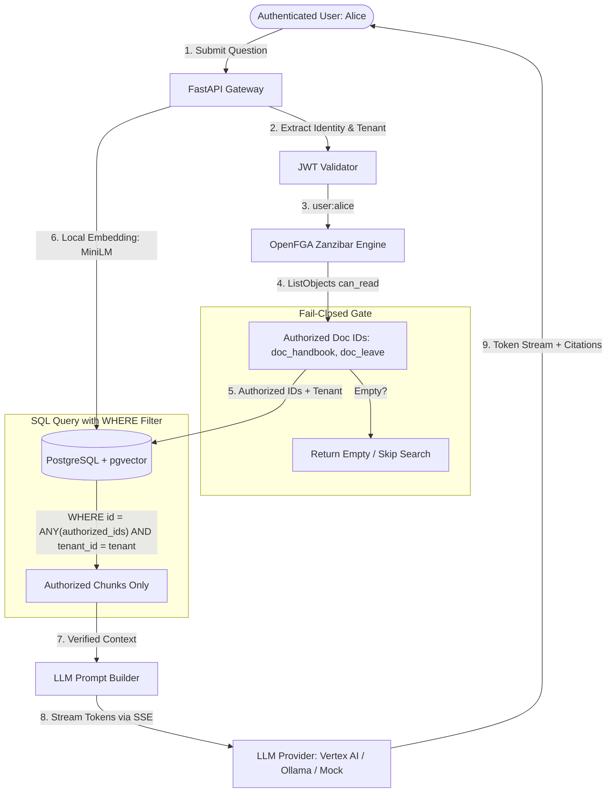
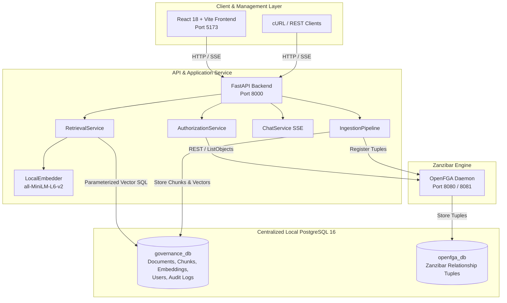
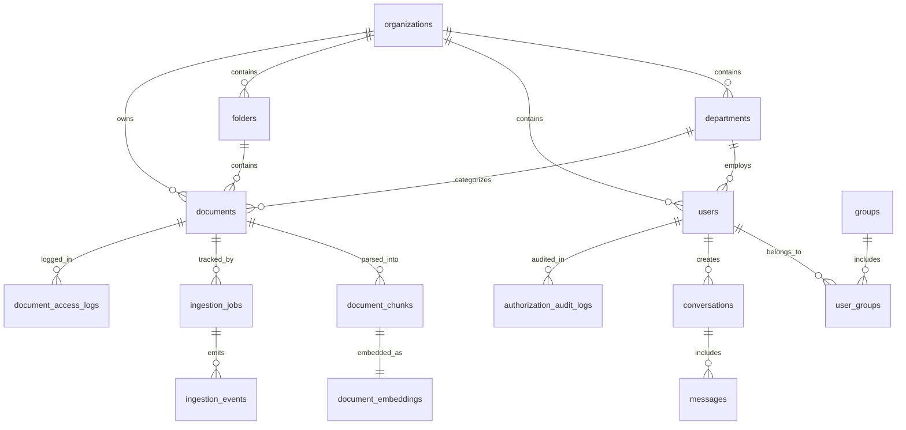

# Enterprise Data Governance System — Phase 1
## Production-Grade Pre-Retrieval ACL Filtering with Zanzibar-Based OpenFGA ReBAC

---

## 1. System Overview

The **Enterprise Data Governance System** is a zero-trust, local-first enterprise data management platform that enforces Relationship-Based Access Control (ReBAC) on Retrieval-Augmented Generation (RAG) pipelines.

Unlike conventional RAG implementations that perform vector similarity search across all documents and then filter out unauthorized chunks afterward (post-retrieval filtering), this architecture implements **Pre-Retrieval ACL Filtering**:
- OpenFGA (Google Zanzibar implementation) computes the user's authorized document set before vector search is executed.
- Authorized document IDs and tenant boundaries are bound directly into the PostgreSQL query `WHERE` clause.
- Unauthorized documents are mathematically excluded from the vector search space; they never leave the database, never enter server memory, and never reach the Large Language Model (LLM).

---

## 2. Why Zanzibar and OpenFGA?

Traditional Role-Based Access Control (RBAC) relies on coarse-grained roles (`admin`, `member`) or static document metadata (`department = 'HR'`). This approach fails in modern enterprise settings:
1. **Inherited & Nested Relationships:** Folders contain documents; groups contain groups; permissions inherit hierarchically.
2. **Dynamic Sharing:** Cross-department documents (e.g. general IT usage policies) need to be shared across distinct organizational units without copying files or polluting role definitions.
3. **Auditability & Revocation Consistency:** Modifying a group membership or revoking a single tuple must immediately revoke access across all downstream documents without re-indexing vector embeddings.

### Google Zanzibar Model
Google Zanzibar is the global authorization architecture powering Google Cloud, Google Drive, and YouTube. **OpenFGA** is the CNCF-backed, open-source Zanzibar engine that represents permissions as a directed graph of relationship tuples:

$$\text{user} \xrightarrow{\text{relation}} \text{object}$$

Examples:
- `user:alice member group:hr`
- `group:hr#member viewer document:doc_employee_handbook`
- `group:hr_managers#member viewer document:doc_salary_records`

---

## 3. What Pre-Retrieval ACL Filtering Means



### Pre-Retrieval vs Post-Retrieval Comparison

| Feature | Vulnerable Post-Retrieval Filtering | Our Pre-Retrieval ACL Filtering |
| :--- | :--- | :--- |
| **Vector Search Scope** | Unrestricted over entire database | Strictly filtered to authorized document IDs |
| **Information Leakage** | Unauthorized titles, scores leak in logs | Unauthorized data never leaves PostgreSQL |
| **Top-K Truncation Risk** | Severe: top-k can be 100% unauthorized, yielding empty result | Zero: top-k applies only within authorized set |
| **Authorization Source** | Hardcoded metadata or header tags | Authoritative OpenFGA Zanzibar graph |
| **OpenFGA Failure Behavior** | Falls back to insecure default | **Fails Closed** (503 Service Unavailable) |

---

## 4. System Architecture



---

## 5. Database Schema

The centralized PostgreSQL instance maintains two isolated databases:
1. `openfga_db`: Managed by OpenFGA for tuple graph storage.
2. `governance_db`: Application entities and pgvector embeddings.



### Table Definitions
- **`organizations`**: Tenants (Acme Corporation). All resources carry `tenant_id`.
- **`departments`**: Functional units (HR, Finance, Sales, IT).
- **`users`**: Principals with bcrypt hashed passwords, role (`admin`, `member`), and tenant scope.
- **`groups` & `user_groups`**: ReBAC group memberships (`group:hr`, `group:finance_managers`).
- **`folders`**: Hierarchical container namespaces supporting inherited permissions.
- **`documents`**: Document metadata, status (`pending`, `processing`, `active`, `failed`), and `openfga_resource_id`.
- **`document_chunks`**: Text windows (500 words, 50-word overlap) with character offsets.
- **`document_embeddings`**: `vector(384)` embeddings with HNSW cosine distance indexing:
  ```sql
  CREATE INDEX ix_document_embeddings_embedding_hnsw
  ON document_embeddings
  USING hnsw (embedding vector_cosine_ops)
  WITH (m = 16, ef_construction = 64);
  ```
- **`authorization_audit_logs`**: Immutable record of every check, grant, revoke, and login event.
- **`document_access_logs`**: Fine-grained access log per document.

---

## 6. OpenFGA Relationship Model (`openfga/model.fga`)

```fga
model
  schema 1.1

type user

type organization
  relations
    define admin: [user]
    define member: [user]

type department
  relations
    define parent: [organization]
    define member: [user, group#member]

type group
  relations
    define parent_department: [department]
    define member: [user]

type folder
  relations
    define owner: [user]
    define parent_department: [department]
    define editor: [user, group#member] or owner
    define viewer: [user, group#member, department#member] or editor or owner
    define can_read: viewer or editor or owner
    define can_write: editor or owner

type document
  relations
    define owner: [user]
    define parent_department: [department]
    define parent_folder: [folder]
    define editor: [user, group#member] or owner or editor from parent_folder
    define viewer: [user, group#member, department#member] or editor or owner or viewer from parent_folder
    define can_read: viewer or editor or owner
    define can_write: editor or owner
```

---

## 7. Department Personas and Permissions

| User | Department | Role | Permitted Documents | Denied Documents |
| :--- | :--- | :--- | :--- | :--- |
| **Alice** | HR | Analyst | Handbook, Leave Policy, Onboarding Policy | Confidential Salary Records, Finance, IT |
| **Helen** | HR | Manager | **All HR Docs** (including Salary Records) | Finance, Sales, IT |
| **Bob** | Finance | Analyst | Financial Statements, Quarterly Revenue, Budget | Payroll Reconciliation, Forecasts, HR |
| **Frank** | Finance | Manager | **All Finance Docs** (including Payroll & Forecasts) | HR Salaries, IT Incident Reports |
| **Charlie**| Sales | Executive | Customer Directory, Pipeline, Quarterly Sales | Pricing Strategy, Sales Forecast, Finance |
| **Sara** | Sales | Manager | **All Sales Docs** (including Pricing Strategy) | HR, IT, Finance Forecasts |
| **David** | IT | Engineer | Infrastructure Arch, Server Runbook, Access Policy | Security Incident Reports, Salaries |
| **Irene** | IT | Admin | **All IT Docs** (including Security Incident Reports) | HR Salaries, Finance Forecasts |
| **Admin** | System | Admin | ReBAC Administration, All Organization Resources | — |

---

## 8. Real-Time Streaming Systems

### A. Streaming AI Responses (SSE)
Endpoint: `POST /api/v1/chat/stream`
Event sequence:
1. `conversation.started`: Initial session metadata and correlation IDs.
2. `authorization.completed`: Reports number of authorized documents and OpenFGA latency.
3. `retrieval.completed`: Reports chunk count and pgvector search latency.
4. `generation.started`: Model starts generating tokens.
5. `token`: Token-by-token payload (`{"content": "..."}`).
6. `citation`: Verified document citations with title and similarity score.
7. `generation.completed`: Total token count and performance telemetry.
8. `error`: Emitted if authorization fails (fail-closed) or model interrupts.

### B. Streaming Document Ingestion
Endpoint: `GET /api/v1/ingestion/jobs/{job_id}/events`
Event sequence:
1. `ingestion.started`
2. `document.validated`
3. `document.extracted`
4. `document.chunked`
5. `embeddings.generated`
6. `permissions.created`
7. `document.indexed`
8. `ingestion.completed`

---

## 9. Quickstart: Running Locally

### Prerequisites
- Docker & Docker Compose
- Python 3.12+ (or `uv`)
- Node.js 18+ (for local frontend dev, or run via Docker)

### Step 1: Clone and Configure Environment
```bash
git clone <repo-url> enterprise-data-governance
cd enterprise-data-governance
cp .env.example .env
```

#### LLM Provider Configuration
In `.env`, configure your preferred LLM provider:
- **Google Cloud Vertex AI (Default):**
  ```env
  LLM_PROVIDER=vertexai
  VERTEX_CREDENTIALS_PATH=vertex_credentials.json
  VERTEX_PROJECT_ID=project-420160a8-73be-41cf-965
  VERTEX_LOCATION=us-central1
  VERTEX_MODEL=gemini-2.0-flash
  ```
- **Local Ollama:**
  ```env
  LLM_PROVIDER=ollama
  OLLAMA_BASE_URL=http://localhost:11434
  OLLAMA_MODEL=llama3.2
  ```
- **Deterministic Mock (for offline testing):**
  ```env
  LLM_PROVIDER=mock
  ```

### Step 2: Start PostgreSQL & OpenFGA
```bash
docker compose up -d postgres openfga
```

### Step 3: Run Master Initialization & Data Seeding
This applies Alembic migrations, creates the OpenFGA store, loads `model.fga`, seeds tuples, and embeds all 24 documents:
```bash
python scripts/initialize.py
```

### Step 4: Start Backend and Frontend
```bash
docker compose up -d backend frontend
```

Access services:
- **Frontend UI:** `http://localhost:5173`
- **Backend API Docs:** `http://localhost:8000/docs`
- **OpenFGA Engine:** `http://localhost:8080`
- **OpenFGA Playground:** `http://localhost:3000`

---

## 10. API Examples (cURL)

### 1. Authenticate (Login as Alice)
```bash
curl -s -X POST http://localhost:8000/api/v1/auth/login \
  -H "Content-Type: application/json" \
  -d '{"email": "alice@acme.com", "password": "password123"}' | jq .
```
Save the returned token:
```bash
export TOKEN="<access_token>"
```

### 2. Check Permission (OpenFGA Zanzibar Check)
```bash
curl -s -X POST http://localhost:8000/api/v1/permissions/check \
  -H "Authorization: Bearer $TOKEN" \
  -H "Content-Type: application/json" \
  -d '{
    "user_id": "alice",
    "relation": "can_read",
    "resource_type": "document",
    "resource_id": "doc_salary_records"
  }' | jq .
# Returns: {"allowed": false}
```

### 3. Stream Permission-Aware Chat Response
```bash
curl -N -X POST http://localhost:8000/api/v1/chat/stream \
  -H "Authorization: Bearer $TOKEN" \
  -H "Content-Type: application/json" \
  -d '{"question": "What is the employee leave policy?"}'
```

### 4. Upload a Document with Ingestion
```bash
curl -X POST http://localhost:8000/api/v1/documents/upload \
  -H "Authorization: Bearer $TOKEN" \
  -F "file=@sample.txt" \
  -F "title=Q4 Operational Guidelines" \
  -F "department_id=22222222-2222-2222-2222-222222222201"
```

### 5. Grant & Revoke Permissions (Admin Only)
Login as Admin:
```bash
export ADMIN_TOKEN=$(curl -s -X POST http://localhost:8000/api/v1/auth/login \
  -H "Content-Type: application/json" \
  -d '{"email": "admin@acme.com", "password": "password123"}' | jq -r .access_token)

# Grant Alice access to Finance Revenue report
curl -X POST http://localhost:8000/api/v1/permissions/grant \
  -H "Authorization: Bearer $ADMIN_TOKEN" \
  -H "Content-Type: application/json" \
  -d '{
    "user_or_group": "user:alice",
    "relation": "viewer",
    "resource_type": "document",
    "resource_id": "doc_quarterly_revenue"
  }'

# Revoke permission
curl -X POST http://localhost:8000/api/v1/permissions/revoke \
  -H "Authorization: Bearer $ADMIN_TOKEN" \
  -H "Content-Type: application/json" \
  -d '{
    "user_or_group": "user:alice",
    "relation": "viewer",
    "resource_type": "document",
    "resource_id": "doc_quarterly_revenue"
  }'
```

---

## 11. Running Automated Tests

Run the full automated test suite:
```bash
pytest backend/tests/ -v
```

All 12 mandatory scenarios are tested, verifying:
- Retriever was **never called** when authorization fails.
- Pre-retrieval filtering limits SQL search to authorized IDs.
- OpenFGA failure fails closed.
- Zero unauthorized tokens or chunks leak to the LLM.

---

## 12. Performance Benchmarks

Run the benchmark suite against the local system:
```bash
python scripts/benchmark.py
```

Target performance bounds:
- **OpenFGA Check Latency:** `< 5 ms`
- **Pre-Retrieval ACL Evaluation (ListObjects):** `< 12 ms`
- **MiniLM Embedding Generation:** `< 30 ms`
- **pgvector HNSW Cosine Search:** `< 8 ms`
- **Total Time-to-First-Token (TTFT):** `< 95 ms`

---

## 13. How to Extend the System

### Adding a New Department
1. Insert into `departments` table in `governance_db`:
   ```sql
   INSERT INTO departments (id, name, slug, organization_id) VALUES (uuid_generate_v4(), 'Legal', 'legal', :org_id);
   ```
2. Create OpenFGA relationship tuple:
   ```json
   {"user": "organization:org_acme", "relation": "parent", "object": "department:dept_legal"}
   ```

### Adding a New User
1. Create user in PostgreSQL with bcrypt hashed password.
2. Assign to group in OpenFGA:
   ```json
   {"user": "user:newuser", "relation": "member", "object": "group:legal"}
   ```
3. Immediate access: no vector database re-indexing is required.

---

## 14. Known Limitations & Production Roadmap

1. **Large Document Collections:** For collections exceeding $10^7$ documents, `ListObjects` results should be partitioned or joined via an embedded OpenFGA relational extension rather than an in-memory ID array.
2. **Distributed Cache Invalidation:** In multi-region deployments, OpenFGA change-data-capture (CDC) tokens should be propagated using Kafka or Debezium to invalidate edge authorization caches.
3. **Model Fine-Tuning:** In Phase 2, embeddings can be upgraded from MiniLM to multi-vector ColBERT or domain-specific legal/financial models.

